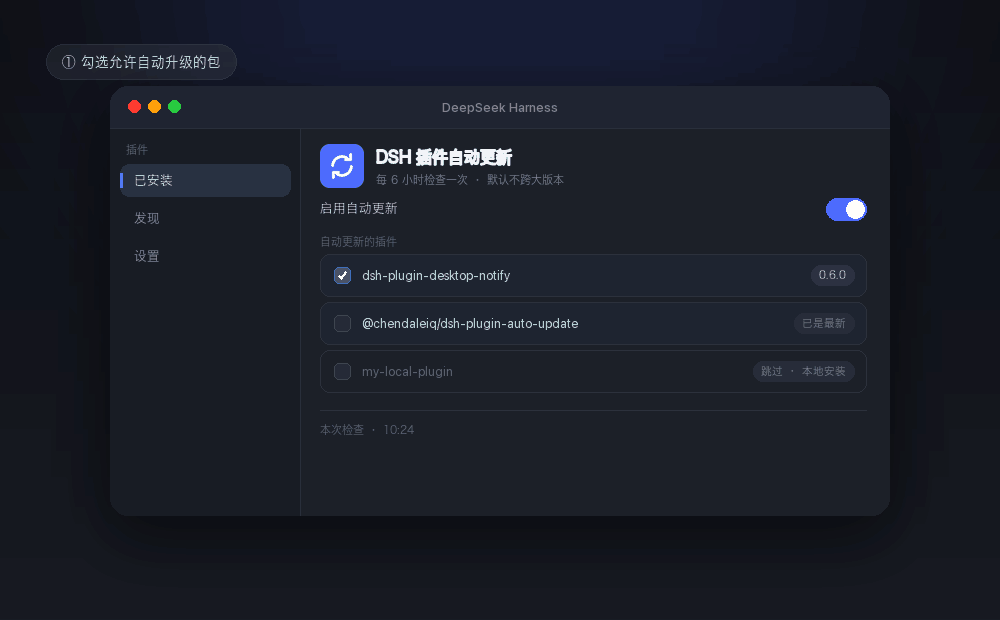

# dsh-plugin-auto-update

Automatic, per-package updates for the DSH plugins you choose: switch it on in the
plugin page and tick the plugins that may upgrade themselves.

[](https://www.npmjs.com/package/@chendaleiq/dsh-plugin-auto-update)
[](LICENSE)
[](https://github.com/chendaleiQ/dsh-plugin-auto-update)



*(Illustration, not a screen recording.)*

## What it does

- Looks up the **newest published version** of installed plugin bundles on npm
- Only touches packages you ticked; local `link:` / `file:` installs, pinned
  versions and bundles with a manager error are skipped
- Never jumps a **major** version and never installs a **prerelease** by default
- Updates go through the profile's running `pluginManager` — profile write lock,
  pnpm run, bundle-patch check and HMR reload stay with it. A failed install
  **reinstalls the previous version**
- Every update lands in an **update history** on the plugin page: which package,
  from which version to which, when, and whether it worked

## Install

Plugins → Install → paste the package name:

```
@chendaleiq/dsh-plugin-auto-update
```

Restart DSH afterwards: a host half only loads on a fresh generation. The GitHub
address and an absolute local directory work the same way.

## Settings: a panel on the plugin's page

Plugins → **DSH Plugin Auto Update**, at the bottom of the detail page:

- **Version policy** — allow a new major, allow prereleases
- **Plugins that may update** — every registry-installed bundle, each with a
  checkbox; the first row means "all of them"
- **Check now** — runs a cycle immediately instead of waiting for the schedule
- To stop it, switch the bundle off in the plugin page; there is no separate
  switch inside the panel
- A bundle that cannot update is greyed out with its reason (local install,
  pinned, or has an error)

Edits apply immediately; no restart.

## Update history

The second section at the bottom of the detail page lists what the automatic
updates actually did, newest first.

- One row per action: time, package, `old → new`, outcome (updated / failed /
  updatable on a dry run)
- A failed row says it rolled back and carries the reason on hover; a host-half
  update is marked "restart to apply"
- **Refresh** reads the list again; **Clear history** asks for a second click
  (the confirmation expires after a few seconds)
- Only version-relevant actions are stored: `current` (already newest) and
  `error` (the registry could not be read) stay in the log, so the list does not
  fill up with cycles
- A repeated identical outcome for one package (the same failing upgrade, the
  same dry-run preview) is stored once

The list lives in `~/.dsh/plugin-auto-update-history.json`, capped at 200 records
(`historyLimit`). The panel reads it through the host half's
`GET /dsh-plugin-auto-update/history` and clears it with `DELETE` on the same
path; a deployment without a web server says the route is unavailable while the
log still records every cycle.

## Language

The copy follows DSH's language setting: Chinese by default, English once the app
is switched.

## Log

`~/.dsh/plugin-auto-update.log`, one JSON object per line (`schedule`, `cycle`,
`notify`, `plugin-started`; actions `current`, `would-update`, `updated`,
`failed`, `error`).

## Deliberate limits

- Only registry-installed bundles whose dependency is a range (`^`, `~`, `*`,
  `latest`); `link:` / `file:` and exact pins are never touched
- Bundles shipped with the app are never touched; your other configuration stays
  as it is
- Registry or manager failures are logged and never interrupt the other packages
- A host half needs an app restart; a renderer half is swapped by HMR

## Advanced

Fields the panel leaves out (`intervalHours`, six hours by default,
`initialDelayMinutes`, `maxUpdatesPerRun`, `dryRun`, `registry`, `timeoutMs`,
`logPath`, `historyPath`, `historyLimit`) live in this bundle's `config` in the profile patch, or as an
override in `~/.dsh/profiles/<profile>/cordis.patch.yml`. Those need a restart.

## Development

```bash
node test/index.test.mjs    # the host half: cycle, history folding and its cap
node test/client.test.mjs   # the renderer half: slot, remote envelope, labels, history route
```

## License

MIT · https://github.com/chendaleiQ/dsh-plugin-auto-update
